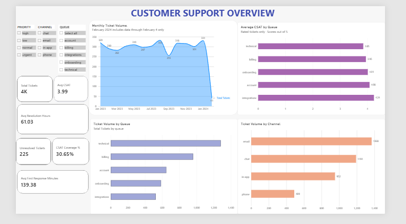
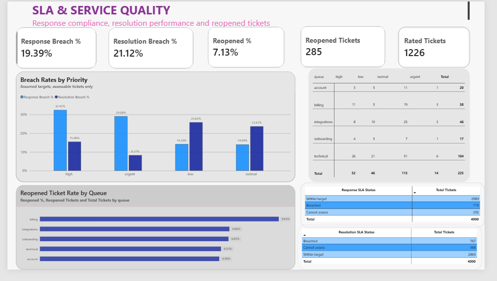

# Customer Support Performance Analytics

An Excel, PostgreSQL and Power BI portfolio project analysing 4,000 support tickets to identify service delays, reopening patterns and customer-feedback gaps.

**Context:** a SaaS-style support operations case study using synthetic data. Findings describe this dataset, not a real company's measured performance. SLA thresholds are project assumptions.

## Dashboard

Two Power BI pages cover ticket demand, service speed, customer satisfaction and SLA performance.

### Support Overview

### SLA & Quality

These are screenshots from the manual build, not newly rendered exports of the packaged PBIX. They may show earlier formatting (such as 4K and the missing matrix title). The editable report is [Customer_Support_Performance.pbix](powerbi/Customer_Support_Performance.pbix).

## Business questions

- Which queues and channels generate the most demand?
- How do response and resolution times differ by queue and priority?
- Which priorities breach the assumed service targets most often?
- Which queues have the highest reopening rates and lowest rated satisfaction?
- Where are tickets without a resolution timestamp concentrated?

The [analysis script](sql/03_analysis.sql) contains the 16 numbered questions and intermediate SLA steps completed during the project.

## Verified headline results

| Metric | Value |
|---|---:|
| Tickets / unique ticket IDs | 4,000 / 4,000 |
| Tickets without resolution timestamp | 225 |
| Average first response | 139.38 minutes |
| Average resolution | 61.03 hours |
| Average CSAT | 3.99 / 5 |
| Rated tickets / coverage | 1,226 / 30.65% |
| Reopened tickets / rate | 285 / 7.13% |
| Response breaches / assessable tickets | 719 / 3,708 (19.39%) |
| Resolution breaches / assessable tickets | 767 / 3,632 (21.12%) |

## Key findings and proposed actions

- Technical has 1,282 tickets, 104 unresolved and the lowest average CSAT (3.85). Review unresolved and low-rated technical cases for recurring issues.
- Integrations has the longest mean resolution time (97.31 hours). Investigate lengthy cases and handoff/dependency delays.
- High priority has the highest response breach rate (32.42%). Review routing and deadline alerts.
- Low priority has the highest resolution breach rate (25.83%), while normal priority has the most resolution breaches (415). Review overdue work without weakening urgent coverage.
- Billing has the highest reopening rate (8.65%). Review reopened cases and closure checks.
- Only 30.65% of tickets have ratings. Improve feedback collection and always show coverage alongside CSAT.

These are investigation priorities, not established root causes or achieved improvements. See [full findings](docs/findings.md).

## Workflow and data quality

1. Excel: inspect missingness and duplicate IDs, calculate elapsed resolution time, flag conflicts and create analysis columns.
2. PostgreSQL: import all 15 prepared fields into text staging, cast to appropriate types, validate and answer business questions.
3. Power BI: load the prepared data, create measures and SLA classifications, build two report pages and compare results with SQL.

The dataset has 149 missing first-response values, 225 missing resolution timestamps and 2,774 missing CSAT scores. Missing values remain blank. There are 143 records where first response exceeds total resolution time; these records remain in ticket, reopened and CSAT analysis but are excluded from both timing metrics. The analysis columns implement that exclusion. No duplicate ticket IDs or reversed date order were found in the supplied workbook.

Opening dates span January 1, 2023 through February 4, 2024. February 2024 is partial. Unresolved means a missing resolution timestamp; this is not a live backlog count.

## Assumed service targets

| Priority | Response minutes | Resolution hours |
|---|---:|---:|
| Urgent | 30 | 24 |
| High | 60 | 48 |
| Normal | 240 | 72 |
| Low | 480 | 120 |

Breached means actual duration is **greater than** the target; equality is within target. Missing analysis durations or targets are `Cannot assess` and are excluded from the breach-rate denominator. Durations use elapsed time, not business hours.

## Repository files

| Folder | Contents |
|---|---|
| data | Complete 15-column prepared CSV, exported from the supplied workbook |
| excel | Original cleaning and analysis workbook |
| sql | Staging setup, validation/transformation, and 16-question analysis |
| powerbi | Original supplied Power BI report |
| docs | Findings, metric definitions, packaging notes and validation totals |
| images | Screenshots from the report-building session |

## Run the SQL in pgAdmin

Use a new, empty PostgreSQL database or a dedicated schema to avoid conflicts with existing tables. The scripts create tables and are intended to run once in sequence.

1. Run `sql/01_create_staging.sql`.
2. Import `data/support_tickets_prepared.csv` into `support_tickets_staging`: CSV, UTF-8, header enabled, comma delimiter, double-quote quote/escape, blank values as NULL. Select all 15 columns in their existing order.
3. Run `sql/02_validate_and_transform.sql` to validate staging and build the typed `support_tickets` table.
4. Run `sql/03_analysis.sql`, or select individual questions.
5. Compare results with `docs/validation_results.json`.

Dates in the packaged CSV use ISO format and preserve seconds. It was exported from Excel's cached calculated values; key calculations were independently checked during packaging.

## Open and refresh Power BI

Open `powerbi/Customer_Support_Performance.pbix` in Power BI Desktop. Its stored CSV source path may point to the author's computer. In Power Query, update the query's Source step or data-source settings to the packaged `data/support_tickets_prepared.csv`, retaining the 15 column names. Check datetime, boolean and numeric types, apply and refresh. Clear filters before comparing headline totals.

The packaged PBIX is unchanged. Its archive and two page definitions were inspected, but Power BI Desktop rendering, embedded model measures and refresh were not executed in this packaging environment. Confirm the refreshed totals locally before publishing.

## Source and scope

Project source recorded during development: Datanemics Support Tickets, https://datanemics.com/datasets/support-tickets/ . Source licensing was not independently rechecked during packaging; verify redistribution terms before public publication. No software license is assigned by this package.

Tools used for the project: Excel, PostgreSQL/pgAdmin and Power BI. Python was used only for repository packaging and independent validation, not as an additional project analysis stage.
